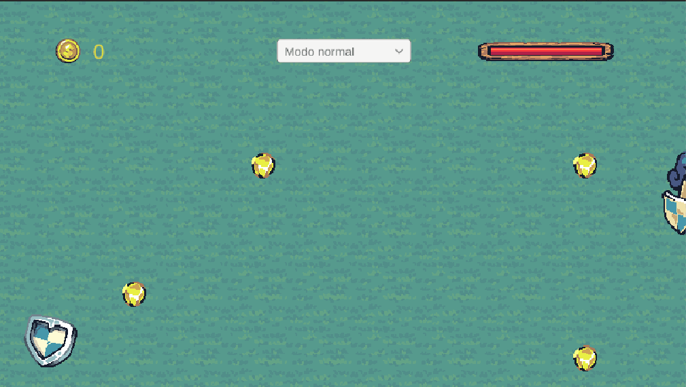
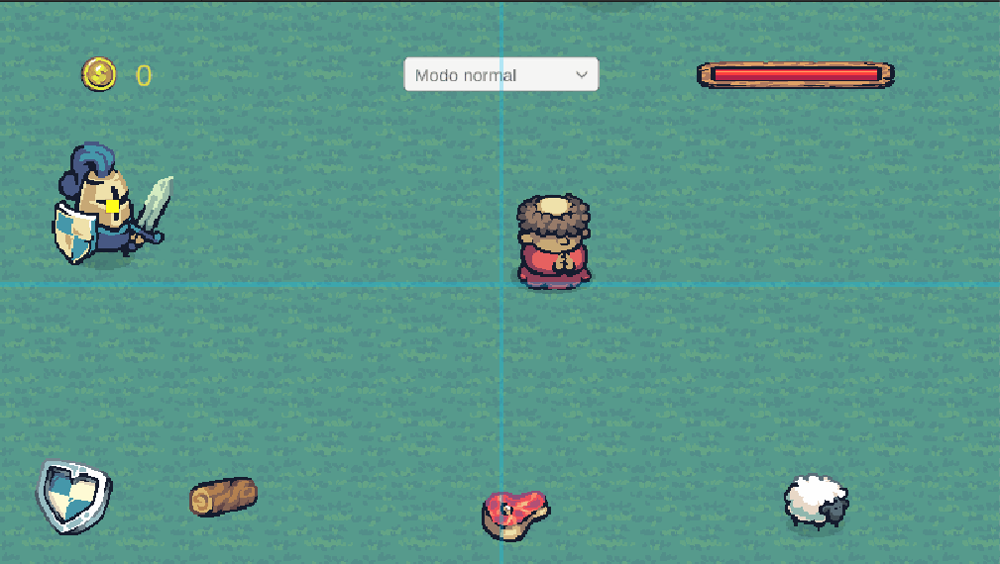

# Cámara

Para esta práctica, se ha reutilizado el proyecto FDV-Eventos para conservar el mismo mundo y agilizar el desarrollo.

Anteriormente se controlaba la cámara del jugador con un script de seguimiento en cada `Update()`. En esta práctica utilizaremos el módulo de CineMachine.

> Instalar el paquete CineMachine y configurar 2 cámaras virtuales con diferentes zonas de seguimiento al jugador. Mostrar el efecto mediante un gif animado. 

Se han configurado dos cámaras.
La primera cuenta con una opciones parecidas a las por defecto en cuanto a las zonas: tiene una zona donde la cámara no sigue al jugador, una zona donde la cámara suavemente intenta seguir al jugador y una zona en la que si se toca, la cámara sigue el movimiento del jugador inmediatamente. En la primera cámara, estas regiones están alrededor del jugador:

Mientras que en la segunda cámara, la región inmediata se ha acortado por los lados mientras que el suavizado se ha mantenido en vertical:

> Define un área de confinamiento diferente para cada una de las dos cámaras de la tarea anterior. Realiza una prueba de ejecución con el correspondiente gif animado que permita ver las diferencias.

Se ha definido un cuadrado y un polígono tal que así:

Una vez asignado a sus correspondientes cámaras virtuales, los resultados son los siguientes:

En el rectángulo, se ve cómo el lado que sobresale de la cámara es el que permite un seguimiento más libre, mientras que el lado que está por dentro de la región de la cámara ya está limitado.

En el caso del polígono ocurre lo mismo. También se puede apreciar como el movimiento de la cámara sigue el borde del polígono al entrar dentro del confinamiento.

> Agrega varios sprites en la escena que estén realizando un movimiento (mínimo 3). Genera una cámara adicional que le haga el seguimiento a dichos objetos.

Se han colocado 3 ovejas que siguen un movimiento senoidal a lo largo de los ejes. Tras esto, se ha añadido una cámara del tipo target group junto con su corriente script. En la cámara, se han configurado como objetivos a seguir las tres ovejas. Además, se ha activado el encuadre automático que permite alejarse si es necesario para que las ovejas estén dentro del frustum. El resultado es el siguiente:

> Agrega 2 sprites adicionales en la escena que estén realizando un movimiento Genera una cámara adicional que le haga el seguimiento a dichos objetos, cada uno con un peso en la importancia del seguimiento diferente.

Ahora se han añadido dos ovejas más y configurado los pesos. A la última oveja se le ha puesto un peso superior para mostrar cómo la cámara le da más importancia y dentro del encuadre, intenta prestarle más atención.

Se puede observar que el movimiento que realiza la cámara es muy similar al que sigue la oveja de la derecha, que es la que más peso tiene, mientras intenta mantener las otras dentro del encuadre en función de su peso y posibilidades.